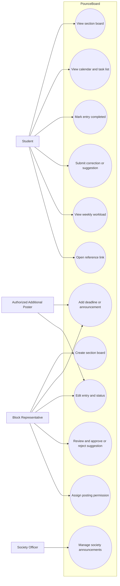

# Product Backlog

## Team Information

- **Team name:** RENEview  
- **Project title:** PounceBoard  
- **Primary user group for the first release:** Students belonging to an MSU-IIT class section or block  
- **Format:** User stories with one detailed use case and testable acceptance criteria

| Member | GitHub username | Personal CSC181 repository |
| :---- | :---- | :---- |
| Juniezsa Cassandra C. Bacus | `fried.ShangHai` | [https\://github.com/Juniezsa/CSC181.git](https://github.com/Juniezsa/CSC181.git) |
| Sammy R. Ditanongun | `slyoh26` | [https\://github.com/slyoh26/CSC181.git](https://github.com/slyoh26/CSC181.git) |
| Jeric I. Balos | `JekoBot` | [https\://github.com/JekoBot/CSC181.git](https://github.com/JekoBot/CSC181.git) |
| Amil H. Popawan | `amillionaire` | [https\://github.com/amillionaire/-CSC181](https://github.com/amillionaire/-CSC181) |

> **Completion note:** The interview log and proposal do not provide interview dates or the names of the team members who conducted each interview. These details are marked **To be supplied by the team** instead of being invented. The same applies to stakeholder validation that is not documented in the supplied files.

## 1\. Interview Summary

The team gathered input from students, block representatives, and a student organization officer. The interviews show that students currently use several channels to receive announcements and maintain separate personal reminders. Block representatives act as intermediaries between instructors and students, and they sometimes need to repeat or correct information. The student organization officer described how announcements are distributed through Messenger, Facebook, and, for some CS announcements, Discord.

| Code | Stakeholder role | Date | Method | Interviewer(s) |
| :---- | :---- | :---- | :---- | :---- |
| V1 | Block representative, 3rd-year BA-FIL | 11/6/26 | Chat interview | Jeric I. Balos |
| V2 | Student organization officer / vice mayor | 11/7/26 | Chat interview | Jeric I. Balos |
| S1 | Student, 1st-year BS Biology (Microbiology) | 11/7/26 | Chat interview | Juniezsa Cassandra C. Bacus |
| S2 | Student, 3rd-year BS Environmental Engineering | 11/7/26 | Chat interview | Juniezsa Cassandra C. Bacus |
| S3 | Student, 4th-year BS ANBIO | 11/7/26 | Chat interview | Juniezsa Cassandra C. Bacus |
| S4 | Student, 2nd-year BSEd Physics | 11/7/26  | Chat interview | Juniezsa Cassandra C. Bacus |
| V3 | Block representative | 10/26/26 | Chat interview | Sammy R. DItanongun |
| S5 | Senior CS student | 11/8/26 | Chat interview | Juniezsa Cassandra C. Bacus |

**Interview coverage:** The log contains at least two stakeholder groups: students and block representatives. It also includes a student organization officer. Instructor announcements are discussed by interviewees, but the log does not contain a separately identified instructor interview. The team should not describe instructors as directly interviewed unless another interview record exists.

## 2\. From Interview Notes to Needs

The findings below separate what interviewees said from the needs inferred by the team. The requirement ideas are proposed system behavior, not claims that the interviewees requested every exact feature.

| ID | Source | What we heard or saw | Underlying need | Requirement idea | Type |
| :---- | :---- | :---- | :---- | :---- | :---- |
| F1 | V1, V3 | Block representatives receive information from instructors through class discussions, group chats, Gchat, email, and MOLE, then relay it to their blockmates. | A section needs one shared place where information from different announcement channels can be collected. | The system shall let an authorized block representative create and publish a section announcement or deadline entry. | F |
| F2 | S1, S2, S3, S4, S5 | Students use different combinations of Google Classroom, MOLE, Gmail/Gchat, Messenger, university websites, and personal notes. Several students said they check more than one platform. | Students need a consolidated view so they do not have to switch between several platforms just to check upcoming requirements. | The system shall display deadlines and announcements from the section's subjects in one section board. | F |
| F3 | S1, S2, S3, S4 | Students use physical checklists, phone reminders, notes, notebooks, and calendars to remember deadlines. One student nearly missed a deadline after confusing this Friday with the following Friday. | Students need clear dates and a reliable way to review upcoming work. | Each entry shall display its title, subject, type, and due date and time, and shall be available in a calendar or task view. | F |
| F4 | V1, V3 | Representatives sometimes repeat announcements when students do not see them. Schedule changes and conflicting information can cause confusion. | Students need to recognize the latest version of an announcement and identify changes. | Authorized users shall be able to edit an entry and mark it as updated, extended, or pending clarification. | F |
| F5 | V1, V3 | Representatives want classmates to contribute additions or corrections, but they also want someone responsible for checking and confirming information. | Students need a way to report possible errors without allowing unverified information to become official. | Students shall be able to submit a suggested entry or correction, while an authorized representative approves or rejects it. | F |
| F6 | S1, S2, S3, S4 | Students prefer having information in one place. Most interviewed students said a consolidated view would make checking easier and reduce confusion. | Students need to find information quickly without searching several conversations or websites. | The system shall provide a section-level list of upcoming entries that can be reviewed together across subjects. | Q |
| F7 | V1, V3, V2 | Representatives and organization officers redistribute updated deadlines or announcements through existing group chats and rely on representatives to pass information along. | Users need updates to be easy to recognize and communicate, while retaining familiar communication channels. | The system shall show the updated entry and its status in the shared board; the prototype will not replace Messenger or provide its own chat. | F |
| F8 | V1, V3, V2 | Busy periods occur around midterms and finals. Interviewees described several requirements or events happening close together and the need to plan around conflicts. | Students and representatives need an overview of how demanding a week will be. | Each academic requirement shall have a workload weight, and the system shall show a weekly workload view based on the entries recorded. | F |
| F9 | V1, V3 | Representatives want to add the subject, activity, deadline, and reminders, and one representative described a quick-entry form with a title, subject, due date/time, and link. | Authorized users need to enter and update information without a lengthy process. | The system shall provide an entry form for title, subject, type, due date/time, workload weight, and optional details or link. | Q |
| F10 | V2 | The organization officer described using Messenger for small announcements and Facebook for announcements that need wider reach. Discord was also used for some CS-related announcements. | Organization-level announcements may need to reach members through a dedicated space while users retain their preferred communication channels. | The system may support a society or organization board in a later release, subject to a confirmed scope and access rules. | F |
| F11 | V2, S5 | The organization officer said students have different preferred communication channels. The senior CS student also preferred verification and said platform preference varies. | The system should complement existing channels instead of assuming every student will abandon them. | PounceBoard shall be a shared reference board and shall not require integration with or replacement of Messenger, Facebook, Discord, MOLE, or Google Classroom in the first release. | C |
| F12 | Proposal, V1, V3 | The proposal states that MOLE integration is outside the semester scope, and interviewees described information coming from several channels. | The first release must work even when information is entered manually. | Authorized users shall manually create and maintain entries; automatic MOLE or Google Classroom importing is excluded from Release 1\. | C |

### Assumption log

These are assumptions or decisions that have not been confirmed by the interviews. They must not be presented as interview findings.

| ID | Assumption | Risk if wrong (High/Medium/Low) | How we will check it |
| :---- | :---- | :---- | :---- |
| A1 | Each section or block will have at least one representative willing and able to maintain its board. | High | Ask representatives from more than one section whether they can take responsibility for creating and updating entries during a prototype trial. |
| A2 | Students will regularly open a separate PounceBoard site or application if it makes cross-subject deadlines easier to review. | High | Run a short usability test with students and ask whether they would use the board alongside their existing channels. |
| A3 | A simple workload classification of Light, Medium, and Heavy will be understandable and useful to students. | Medium | Show sample weeks with different combinations of weights and ask testers to explain the workload indicator. |
| A4 | Representatives can verify student-submitted corrections before they are shown as official updates. | High | Walk through the proposed approval process with representatives and ask who should have approval rights. |
| A5 | The team can implement the core board, entry management, calendar/task view, and workload summary within the semester. | High | Estimate each story with the team, build a small technical prototype, and review progress at weekly checkpoints. |
| A6 | Society or organization boards can be added without making the first-release section board too complicated. | Medium | Keep society boards outside the MVP and revisit after the section workflow has been tested. |

## 3\. User Stories

**Roles used:** A *student* is a member of a section board. A *block representative* is an authorized board manager. A *contributor* is a student allowed to submit a proposed entry or correction. A society *officer* manages a society board only if that feature is included in a later release.

| ID | User story | Source finding(s) | Epic | INVEST check |
| :---- | :---- | :---- | :---- | :---- |
| US-01 | As a student, I want to view my section's shared board so that I can check upcoming requirements across my subjects in one place. | F2, F6 | Find section information | Yes |
| US-02 | As a block representative, I want to create a section board so that members of my block have a shared place for deadlines and announcements. | F1, F2 | Set up a section board | Yes |
| US-03 | As a block representative, I want to add an entry with its title, subject, type, due date and time, and workload weight so that students receive the important details of a requirement. | F1, F3, F8, F9 | Manage board entries | Yes |
| US-04 | As a student, I want to view entries in a calendar and task list so that I can understand what is due and when. | F2, F3, F6 | Review deadlines | Yes |
| US-05 | As a student, I want to mark an entry as completed so that I can keep track of the requirements I have finished. | F3, F6 | Review deadlines | Yes |
| US-06 | As a block representative, I want to edit an entry and identify it as updated or extended so that students can distinguish the latest information from an earlier deadline. | F4, F7 | Maintain accurate information | Yes |
| US-07 | As a student, I want to submit a correction or suggested entry so that information that may be missing or incorrect can be brought to the representative's attention. | F5 | Verify board information | Yes |
| US-08 | As a block representative, I want to approve or reject a submitted correction so that unverified information does not become an official board entry. | F5, F7 | Verify board information | Yes |
| US-09 | As a student, I want to see a weekly workload overview based on the weight of upcoming requirements so that I can plan ahead for busy weeks. | F8 | Plan weekly workload | Yes |
| US-10 | As a block representative, I want to assign another trusted member permission to post entries so that the board can still be updated when I am unavailable. | V1, F1, F9 | Manage board access | Yes |
| US-11 | As a student, I want to join a society board so that I can see announcements relevant to an organization I belong to. | F10, F11 | Society announcements | Yes |
| US-12 | As a student, I want to open an entry's optional reference link so that I can go to the original instructions or submission page. | F1, F9 | Review deadlines | Yes,  |

### Epics and how we split them

| Epic | Split into | How we split it |
| :---- | :---- | :---- |
| Set up a section board | US-02, US-01 | Happy path first: create the board, then let students view it. |
| Manage board entries | US-03, US-06 | By workflow step: add an entry, then maintain it when details change. |
| Review deadlines | US-04, US-05, US-12 | By user action: view entries, track completion, and open a supporting link. |
| Verify board information | US-07, US-08 | By workflow step: submit a proposed change, then approve or reject it. |
| Plan weekly workload | US-09 | Kept as a focused story because it provides a distinct weekly planning outcome. |
| Manage board access | US-10 | By business rule: only an authorized representative can grant posting permission. |
| Society announcements | US-11 | Kept separate because it concerns a different board membership and may be delivered after the core section workflow. |

### Stories we rewrote

1. **Before:** As a student, I want an app that combines Google Calendar, Tasks, and Classroom so that I can manage everything. **After:** As a student, I want to view my section's shared board so that I can check upcoming requirements across my subjects in one place (US-01). Separate stories cover calendar/task viewing (US-04) and completion tracking (US-05). **Reason:** The original story combined several large features and did not identify a clear, independently testable outcome. It was too large and insufficiently independent.  
     
2. **Before:** As a user, I want everyone to add and edit deadlines so that the board stays updated. **After:** Students submit proposed additions or corrections (US-07), and a block representative approves or rejects them (US-08). **Reason:** The original story did not define who could make an official change. The split makes the permission rule clear and reduces the risk of unverified information becoming official.  
     
3. **Before:** As a block representative, I want to post announcements so that everyone knows what is happening. **After:** US-03 covers creating a structured deadline entry, while US-06 covers changing an existing entry and identifying its updated status. **Reason:** Adding information and correcting information are separate workflows with different acceptance conditions.

## 4. Acceptance Criteria

The criteria below use observable outcomes. Each story has at least three criteria, including an unhappy path. Given–When–Then scenarios are included for every Must-have story in the ordered backlog.

### US-01: View the section board

**Acceptance criteria:**

- [ ] Given a student is a member of a section board, when the student opens the board, then the system displays the entries belonging to that section.
- [ ] Each displayed entry shows its title, subject, type, due date and time, and workload weight when those fields are present.
- [ ] (unhappy) Given a student is not a member of a section board, when the student attempts to open its restricted board, then the system denies access and displays an access message.

### US-02: Create a section board

**Acceptance criteria:**

- [ ] Given an authorized user has entered a valid section name, when the user submits the create-board form, then the system creates one board with that section name.
- [ ] The user who creates the board is recorded as its initial board manager.
- [ ] (unhappy) Given the section name is blank, when the user submits the form, then the system does not create a board and identifies the required field.

### US-03: Add a deadline or announcement entry

**Acceptance criteria:**

- [ ] The entry form requires a title, subject, type, due date and time, and workload weight.
- [ ] Given all required fields contain valid values, when an authorized poster saves the entry, then the entry appears on the correct section board with the submitted details.
- [ ] (unhappy) Given a required field is missing or the date/time value is invalid, when the poster submits the form, then the system does not save the entry and identifies the field that needs correction.

### US-04: View calendar and task list

**Acceptance criteria:**

- [ ] The student can switch between a calendar view and a task-list view of the same section entries.
- [ ] Entries in the calendar appear on their saved due dates, and task-list entries display their due date and time.
- [ ] (unhappy) Given the selected section has no entries for the displayed period, when the student opens the view, then the system displays an empty-state message instead of misleading or unrelated entries.

### US-05: Mark an entry as completed

**Acceptance criteria:**

- [ ] Given an entry is not completed, when the student marks it as completed, then the interface displays its completed status.
- [ ] The completed status remains visible when the student changes between the calendar and task-list views.
- [ ] (unhappy) Given an entry cannot be found or is no longer available, when the student attempts to mark it complete, then the system displays an error and does not change another entry.

### US-06: Edit an entry and show its status

**Acceptance criteria:**

- [ ] An authorized poster can edit the title, subject, type, due date/time, workload weight, and optional details of an existing entry.
- [ ] When a saved entry's deadline changes, the board displays the latest saved deadline and the selected status label, such as Updated or Extended.
- [ ] (unhappy) Given a user without posting permission attempts to edit an entry, when the user submits the change, then the system rejects the change and leaves the saved entry unchanged.

### US-07: Submit a suggested entry or correction

**Acceptance criteria:**

- [ ] A student can submit a proposed entry or correction with a description of the suggested information.
- [ ] After submission, the system records the suggestion as pending and makes it available to an authorized representative for review.
- [ ] (unhappy) Given the suggestion has no description, when the student submits it, then the system rejects the submission and identifies the missing information.

### US-08: Approve or reject a suggestion

**Acceptance criteria:**

- [ ] An authorized representative can view pending suggestions for the representative's section board.
- [ ] When the representative approves a valid suggestion, the system applies the proposed change to the board and changes the suggestion's status to Approved.
- [ ] (unhappy) When the representative rejects a suggestion, the system does not apply the proposed change and records the suggestion as Rejected.

### US-09: View weekly workload

**Acceptance criteria:**

- [ ] The weekly view groups section entries by their due dates within the selected week.
- [ ] The workload summary uses the saved Light, Medium, and Heavy weights of entries in that week.
- [ ] (unhappy) Given the selected week has no entries, when the student opens the workload view, then the system displays a no-upcoming-requirements message and does not label the week as busy.

### US-10: Assign another poster

**Acceptance criteria:**

- [ ] An authorized representative can select a member of the same section and grant that member posting permission.
- [ ] A member with posting permission can create and edit entries on that section board.
- [ ] (unhappy) A student without board-management permission cannot grant posting permission to another member.

### US-11: Join a society board

**Acceptance criteria:**

- [ ] A student can view the list of society boards made available in the system.
- [ ] When a student joins an available society board, that board's announcements become visible to the student.
- [ ] (unhappy) When a society board is restricted and the student is not an approved member, the system denies access to its restricted announcements.

### US-12: Open an entry's reference link

**Acceptance criteria:**

- [ ] When an entry contains a valid reference link, the student can select it to open the linked resource.
- [ ] When an entry has no reference link, the system does not display a non-functional link control.
- [ ] (unhappy) When a saved reference link is malformed or cannot be opened, the system displays an error or unavailable-link message without changing the entry.

### Given–When–Then scenarios for Must-have stories

The proposed Must-have stories are US-01, US-02, US-03, US-04, US-06, and US-09. The team should confirm this priority set during planning.

#### US-01: View the section board

**Scenario 1: Member views the board**

```gherkin
Given a student is a member of the "BSCS-2A" section board
And the board contains "Calculus Quiz" for November 13, 2026 at 9:00 AM
When the student opens the "BSCS-2A" board
Then the system displays "Calculus Quiz" with its subject and due date
```

**Scenario 2: Non-member is blocked (unhappy)**

```gherkin
Given a student is not a member of the "BSCS-2A" section board
When the student attempts to open that board
Then the system denies access
And the system displays an access message
```

#### US-02: Create a section board

**Scenario 1: Valid board is created**

```gherkin
Given an authorized user is on the create-board page
When the user enters "BSCS-2A" as the section name and submits the form
Then the system creates the "BSCS-2A" board
And records the creator as its initial board manager
```

**Scenario 2: Required section name is missing (unhappy)**

```gherkin
Given an authorized user is on the create-board page
When the user submits the form without a section name
Then the system does not create a board
And displays a message that the section name is required
```

#### US-03: Add a deadline or announcement entry

**Scenario 1: Valid entry is saved**

```gherkin
Given a block representative manages the "BSCS-2A" board
When the representative enters "Calculus Quiz", "MAT061", "Quiz",
"November 13, 2026 at 9:00 AM", and "Medium"
And submits the entry
Then the system saves the entry to the "BSCS-2A" board
And displays the submitted details to board members
```

**Scenario 2: Missing required field (unhappy)**

```gherkin
Given a block representative is creating an entry
When the representative leaves the subject field blank and submits the form
Then the system does not save the entry
And identifies the subject field as required
```

#### US-04: View calendar and task list

**Scenario 1: Student switches views**

```gherkin
Given the section board contains "Physics Report" due November 14, 2026
When the student opens the calendar view
Then "Physics Report" appears on November 14, 2026
When the student switches to the task-list view
Then "Physics Report" appears with the same due date
```

**Scenario 2: Selected period has no entries (unhappy)**

```gherkin
Given the selected week has no saved section entries
When the student opens the calendar view for that week
Then the system displays an empty-state message
And does not display entries from another section
```

#### US-06: Edit an entry and show its status

**Scenario 1: Representative extends a deadline**

```gherkin
Given a block representative manages an entry due November 13, 2026 at 9:00 AM
When the representative changes the due date to November 15, 2026 at 9:00 AM
And sets the status to "Extended"
Then the system saves the new due date
And displays the "Extended" status on the board
```

**Scenario 2: Unauthorized edit is rejected (unhappy)**

```gherkin
Given a student has no posting permission on the section board
When the student attempts to change an entry's due date
Then the system rejects the change
And the original due date remains unchanged
```

#### US-09: View weekly workload

**Scenario 1: Busy week is summarized**

```gherkin
Given the selected week contains one Light entry, one Medium entry,
and two Heavy entries
When the student opens the weekly workload view
Then the system lists the four entries under their due dates
And displays a workload summary based on their saved weights
```

**Scenario 2: Week has no entries (unhappy)**

```gherkin
Given the selected week contains no section entries
When the student opens the weekly workload view
Then the system displays a no-upcoming-requirements message
And does not mark the week as busy
```

## 5. Quality Requirements and Constraints (EARS)

The interview log does not contain agreed numerical performance targets. Therefore, this section uses testable behavior without inventing response-time or availability figures. Any numerical target must be discussed with stakeholders and recorded later.

| ID | Requirement | EARS pattern | Type | Source | Number agreed with |
|---|---|---|---|---|---|
| NFR-01 | While a user is viewing a section board, the system shall display only entries belonging to that board and shall show each entry's saved date and time consistently in the calendar and task-list views. | State-driven | Quality | F2, F3, F6 | N/A, proposed by team |
| NFR-02 | When an authorized user saves an entry or an edit, the system shall display the saved information on the relevant section board. | Event-driven | Quality | F1, F4, F9 | N/A, proposed by team |
| NFR-03 | The system shall require authorization before a user can create a board, publish an official entry, approve a suggestion, or grant posting permission. | Ubiquitous | Constraint / Security | F5, F7, F11 | N/A, proposed by team |
| NFR-04 | When a required entry field is missing or invalid, the system shall identify the field and prevent the incomplete entry from being saved. | Event-driven | Quality | F3, F9 | N/A, proposed by team |
| NFR-05 | The system shall not require automatic integration with MOLE, Google Classroom, Messenger, Facebook, or Discord in the first release. | Ubiquitous | Constraint | F11, F12 | N/A, stated in proposal scope |

## 6. Use Case

### Use-case diagram



**Diagram note:** Society announcements (US-11) are a later-release capability. The diagram includes it to show the wider proposed system, not to imply that it belongs in the first-release MVP.

### UC-01: Add and publish a section deadline

| Field | Description |
|---|---|
| Primary actor | Block representative or authorized additional poster |
| Precondition | The actor is signed in, has posting permission, and has access to an existing section board. |
| Main success scenario | 1. The actor opens the section board. 2. The actor selects the option to add an entry. 3. The system displays the entry form. 4. The actor enters the title, subject, type, due date and time, workload weight, and any optional details or reference link. 5. The actor submits the form. 6. The system validates the required fields. 7. The system saves the entry to the selected section board. 8. The system displays the new entry in the board and relevant calendar, task-list, and workload views. |
| Extensions | **4a. Missing or invalid information:** The actor leaves a required field blank or enters an invalid date/time. The system identifies the field, does not save the entry, and returns the actor to the form. **5a. Actor lacks permission:** The system rejects the attempt to publish and leaves the board unchanged. **6a. Actor cancels:** The system discards the unsaved form and returns to the board. |
| Postcondition | A valid entry is saved to the selected board and is visible to its authorized members. No entry is created if validation or authorization fails. |
| Stories covered | US-03, US-01, US-04, US-09, US-12 |

## 7\. Story Map

The journey follows the core workflow: access a section board, add or find requirements, review them, and plan the week. Release 1 is arranged as a complete path through all four journey steps.

|  | 1\. Access a section board | 2\. Add and maintain entries | 3\. Review requirements | 4\. Plan the week  |
| :---- | :---- | :---- | :---- | :---- |
| **Release 1 (MVP)** | US-02 Create a section board; US-01 View the board  | US-03 Add an entry; US-06 Edit an entry | US-04 View calendar and task list; US-12 Open reference link | US-09 View weekly workload |
| **Release 2** | US-10 Assign another poster | US-07 Submit a correction; US-08 Approve or reject a suggestion  |  US-05 Mark an entry completed  | Improve workload summaries after user testing |
| **Later** | US-11 Join a society board | Society officer manages society announcements | Browse announcements from joined societies | Consider additional planning features after validation |

## 8\. The Ordered Backlog

The table contains every user story exactly once. The order is a proposed team prioritization, with no tied ranks. Size estimates are relative: S means small, M means medium, and L means large.

| Rank | Story | MoSCoW | Size (S/M/L) | Value / effort quadrant | Sprint |
| :---- | :---- | :---- | :---- | :---- | :---- |
| 1 | US-02 Create a section board | Must | M | Big bet | Sprint 1 |
| 2 | US-03 Add a deadline or announcement entry | Must | M | Big bet | Sprint 1 |
| 3 | US-01 View the section board | Must | S | Quick Win | Sprint 1 |
| 4 |  US-04 View calendar and task list | Must | M | Big bet | Sprint 2 |
| 5 | US-06 Edit an entry and show its status | Must | M | Big bet | Sprint 2 |
| 6 | US-09 View weekly workload | Must | L | Big bet | Sprint 2, split before implementation |
| 7 | US-07 Submit a suggested entry or correction | Should | M | Big bet | Sprint 3  |
| 8 | US-08 Approve or reject a suggestion | Should | M | Big bet | Sprint 3 |
| 9 | US-05 Mark an entry as completed  | Should | S | Quick win | Sprint 3 |
| 10 | US-10 Assign another poster | Could | M | Big bet | Later |
| 11 |  US-12 Open an entry's reference link | Could | S | Quick win | Later |
| 12 | US-11 Join a society board | Won’t this release | L | Money pit for this semester's scope | Not this time\|  |

### How we ordered it

The first stories establish the section board and the ability to publish reliable entries, because the rest of PounceBoard depends on having a board and usable deadline data. Viewing the board is also essential because students are the primary users who need to find information across subjects. Calendar and task-list views, entry updates, and the weekly workload view follow because they turn the saved entries into useful planning information. Suggestion moderation is important for data accuracy, but it can follow the basic posting workflow; society boards are deferred because the proposal identifies the section board as the core semester project and the wider organization feature needs additional access rules.

### Capacity check

| Question | Answer |
| :---- | :---- |
| How many Must-have stories, and their total size? | 6 Must-have stories: 1 S, 4 M, and 1 L. The total is 1 S \+ 4 M \+ 1 L. |
| Do the Must-haves fit in about 60% of our time for two sprints? | **Not confirmed.** The proposal identifies limited time and developing team skills as constraints, but it does not provide sprint capacity or estimates in points/hours. The team should estimate the stories and split US-09 before committing. If the estimate exceeds roughly 60% of the two-sprint capacity, move a lower-value Must-have or reduce its first-release scope with stakeholder agreement.   |
| Do the Release 1 stories form one complete path through the core workflow? | **Yes, as a proposed path**: create a board, add and update entries, view them across subjects, and review the weekly workload.  |
| Are all L-sized Must-have stories split? | **Not yet.** US-09 is identified as L and must be decomposed into smaller implementation tasks before sprint commitment. The user story remains one user outcome in the backlog.  |

## 9\. Definition of Done

A story is considered done only when all applicable conditions are met.

- [ ] The implemented behavior matches the story and its acceptance criteria.  
- [ ] The normal path and at least one relevant unhappy path have been tested.  
- [ ] Required-field validation and permission checks work for the story.  
- [ ] The feature displays the correct section's data and does not expose another section's restricted entries.  
- [ ] The interface uses consistent names for subjects, entry types, dates, times, and workload weights.  
- [ ] The feature has been reviewed by at least one other team member.  
- [ ] Any discovered defect affecting the acceptance criteria has been fixed and retested.  
- [ ] The code and any relevant documentation have been committed to the team's repository.  
- [ ] The team can demonstrate the completed story using the project's demo data.

## 10\. Traceability Table

Each Must-have story from Section 8 is traced to the problem it addresses and the findings behind it. Test case IDs will be added in Week 9\.

| Story | Problem or goal it addresses | Source finding(s) | Test cases (Week 9\) |
| :---- | :---- | :---- | :---- |
| US-02 Create a section board | A section has no single shared place for deadlines and announcements; information arrives through group chats, Gchat, email, and MOLE. | F1, F2 |  |
| US-03 Add a deadline or announcement entry | Representatives need a quick way to record a requirement with its title, subject, type, due date and time, and workload weight so students get the important details. | F1, F3, F8, F9 |  |
| US-01 View the section board | Students switch between several platforms to check what is due across their subjects. | F2, F6 |  |
| US-04 View calendar and task list | Students confuse dates (for example, this Friday and next Friday) and need a clear view of what is due and when. | F2, F3, F6 |  |
| US-06 Edit an entry and show its status | Schedule changes and conflicting information cause confusion; students need to recognize the latest version of a deadline. | F4, F7 |  |
| US-09 View weekly workload | Several requirements fall close together around midterms and finals; students need to see how demanding a week will be. | F8 |  |

Gaps found: Every Must-have story traces to at least one finding, so there are no stories without a goal. F5 (student corrections and approval) is covered only by US-07 and US-08, which are Should-haves planned for Release 2 because the core board works without them. F10 (society boards) is covered only by US-11, which is a Won't-have for this release (see A6). F11 and F12 are constraints rather than features, so they are traced to Section 5 instead of to a story.

## 11\. Validation

### Team review

The team checked the findings and stories against INVEST, the quality checklist, and the list of common mistakes. The problems found and how each one is fixed are listed below.

| Problem found | Story or requirement | How we fixed it |
| :---- | :---- | :---- |
| The source column cites an interview code (V1) instead of a finding ID, so the story cannot be traced through Section 2\. | US-10 | Changed the source to F1, F9. |
| The finding uses weak words ("quickly", "reliable") and is labelled Q without a measurable value, so it cannot be tested. | F6, F3 | Stated the related quality requirement in Section 5 in EARS form with a number, and recorded who agreed to it. |
| F9 describes an entry form, which is a feature, but it is labelled Q. | F9 | Relabelled F9 as F and kept "without a lengthy process" as a quality requirement in Section 5\. |
| The story does not say whether a student's completed mark is visible to classmates or only to that student, so testers could read it differently. | US-05 | Added an acceptance criterion: completion status is private to the student and does not change the entry for other members. |
| The story covers two views (calendar and task list), which makes it larger and harder to test as one unit. | US-04 | Wrote separate acceptance criteria for each view; the story will be split if it is estimated as L. |
| A Must-have story is sized L, so it is too large to finish within one sprint. | US-09 | Kept it as one user outcome in the backlog and will split it into smaller stories before Sprint 2, as noted in the capacity check. |

### Stakeholder walk-through

\[Show the story map and the top of the backlog to at least one stakeholder you interviewed. See Week 4, slide 31.\]

| Stakeholder | Date | What they said | What we changed |
| :---- | :---- | :---- | :---- |
| \[Code and role\] | \[YYYY-MM-DD\] | \[Feedback\] | \[Change\] |

## 12\. Open Questions for Sprint 1

1. How will students join a section board: an invite link, a join code, or approval by the block representative? How will users sign in, for example with their MSU-IIT Google account?  
2. Can a student belong to more than one section board, such as an irregular student who takes subjects with different blocks? If so, how will entries from several boards be shown together?  
3. Who decides an entry's workload weight (Light, Medium, or Heavy), and can it be changed after posting? (A3, US-09)  
4. Besides the block representative, who should have permission to post entries or approve corrections, and can that permission be removed? (A4, US-10)  
5. What should happen to an entry after its due date passes: stay visible, move to an archive, or be hidden?

## 13\. Member Contribution Record

\[Record actual contributions, including interviews, analysis, writing stories and criteria, and reviewing.\]

| Member | Interviews or analysis | Stories, criteria, or use case | Review or validation |
| :---- | :---- | :---- | :---- |
| Jeric I. Balos | Contributed two initial problem ideas and participated in comparing and selecting the project problem. | Wrote parts 7-9. The story map, The ordered backlog, and The definition of done | Pointed out problems to select stories |
| Sammy R. DItanongun | Interviewed a block representative and analysed most of the responses gathered by the interviews. | Wrote parts 1-3. | Reviewed most parts from parts 1-12. |

## 14\. References

\[List the lecture slides and external sources used. Write None if no external sources were used.\]

| Member who used AI | Tool | Purpose and sections assisted | How output was checked or revised |
|---|---|---|---|
| Sammy R. Ditanongun | ChatGPT | Helped organize the supplied interview log and project proposal into the product backlog, including findings, assumptions, user stories, acceptance criteria, use case, story map, prioritization, and draft validation sections. | The team must compare every finding against the original interview log and proposal, correct any inaccurate interpretation, confirm estimates and priorities, and replace all pending fields with actual team records. |

### Main prompts or interaction summary

The user asked ChatGPT to complete the product backlog template using the interview log and project proposal. ChatGPT used those supplied files to draft the sections and identify information that was not present in the sources. AI-generated suggestions in this document are not evidence of actual stakeholder interviews, stakeholder feedback, team meetings, or completed validation. The team remains responsible for checking and revising the document.

We acknowledge that AI-generated suggestions are not evidence of actual stakeholder interviews, feedback, or verified user needs. Every finding in Section 2 and every walk-through in Section 11 must come from a real person the team spoke to or observed. We remain responsible for the accuracy and explainability of this submission.

## 16\. Team Confirmation

We confirm that this document reflects our team's agreed-upon product backlog. All members listed below reviewed the final version, and each member will upload the same Markdown file to their personal CSC181 repository.

## 16\. Team Confirmation

We confirm that this document reflects our team's agreed-upon product backlog. All members listed below reviewed the final version, and each member will upload the same Markdown file to their personal CSC181 repository.

| Member | Reviewed final version |
| :---- | :---- |
| Jeric I.Balos | Yes |
| Sammy R. Ditanongun | Yes |

## Submission Checklist

- [ ] Interviews cover at least two stakeholder groups, with sources coded and no personal information.  
- [ ] The needs table has at least 8 findings, each labelled F, Q, or C.  
- [ ] Assumptions are recorded separately from evidence.  
- [ ] There are 10 to 15 user stories, each with a real role, a "so that", and at least one finding.  
- [ ] Epics are split, and at least two rewrites are recorded.  
- [ ] Every story has at least 3 acceptance criteria, including an unhappy path, with no weak words.  
- [ ] Every Must-have story has at least 2 Given–When–Then scenarios.  
- [ ] At least 3 quality requirements or constraints use EARS patterns.  
- [ ] One use case has a diagram, a main success scenario, and at least 2 extensions.  
- [ ] The story map has a Release 1 line that crosses every journey step.  
- [ ] Every story has a MoSCoW label and a size, and the backlog is in one order with no ties.  
- [ ] Must-haves fit in about 60% of capacity. Won't-have stories are kept, not deleted.  
- [ ] A Definition of Done is included.  
- [ ] The traceability table covers every Must-have story.  
- [ ] The team review and the stakeholder walk-through are recorded.  
- [ ] Contributions, references, and AI use are declared.  
- [ ] All members reviewed the same final document.  
- [ ] Each member saved the file as `activities/product-backlog.md`, with images in `activities/backlog-images/`.  
- [ ] Each member committed and pushed their copy to their personal repository.  
- [ ] Each member submitted their own GitHub file link through MOLE before November 9, 2026 23:59:59.
